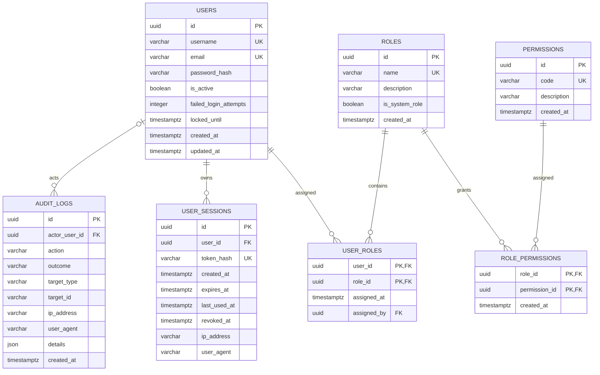

# Identity and Access Management (IAM) Schema

## 1. Scope and implementation status

This document describes the IAM and security-event schema currently represented by the SQLAlchemy models and Alembic migrations in this repository.

**Implemented tables:**
- `users`
- `roles`
- `permissions`
- `user_roles`
- `role_permissions`
- `user_sessions`
- `audit_logs`

The customer, account, transaction, ledger and token-vault entities in [database-design.md](database-design.md) remain planned and are not part of the current database schema.

## 2. Entity relationship diagram

The ER diagram below reflects the current model definitions. GitHub renders Mermaid diagrams directly in Markdown.

Relationship notes:
- A user can receive multiple roles; a role can be assigned to multiple users through `user_roles`.
- A role can grant multiple permissions; a permission can belong to multiple roles through `role_permissions`.
- Each session belongs to one user. The session token itself is not stored; only its hash is persisted.
- An audit log may reference an actor user. The actor is nullable so events without an authenticated user can also be recorded.
- `user_roles.assigned_by` is a nullable foreign key to the user who made the assignment.

## 3. Users

Table: `users`

| Column | Type | Rules |
|---|---|---|
| id | UUID | Primary key |
| username | VARCHAR(50) | Required; unique ignoring case |
| email | VARCHAR(255) | Required; unique ignoring case |
| password_hash | VARCHAR(255) | Required |
| is_active | BOOLEAN | Required; default true |
| failed_login_attempts | INTEGER | Required; default 0; non-negative |
| locked_until | TIMESTAMPTZ | Nullable |
| created_at | TIMESTAMPTZ | Required |
| updated_at | TIMESTAMPTZ | Required |

Passwords are hashed using Argon2id and are not stored in plaintext. Case-insensitive uniqueness is enforced by database indexes.

## 4. Roles

Table: `roles`

| Column | Type | Rules |
|---|---|---|
| id | UUID | Primary key |
| name | VARCHAR(50) | Required; unique ignoring case |
| description | VARCHAR(255) | Nullable |
| is_system_role | BOOLEAN | Required; default false |
| created_at | TIMESTAMPTZ | Required |

The initial seeded roles are:
- `system_admin`
- `security_officer`
- `bank_analyst`
- `customer_support`
- `customer`
- `auditor`

## 5. Permissions

Table: `permissions`

| Column | Type | Rules |
|---|---|---|
| id | UUID | Primary key |
| code | VARCHAR(100) | Required; unique ignoring case |
| description | VARCHAR(255) | Nullable |
| created_at | TIMESTAMPTZ | Required |

Permission codes follow the `resource:action` convention, for example `account:read`, `transaction:create`, `security_event:read` and `role:assign`. The presence of a permission code does not imply that the associated banking resource table is already implemented.

## 6. User roles

Table: `user_roles`

| Column | Type | Rules |
|---|---|---|
| user_id | UUID | Primary key; foreign key to `users.id` |
| role_id | UUID | Primary key; foreign key to `roles.id` |
| assigned_at | TIMESTAMPTZ | Required |
| assigned_by | UUID | Nullable foreign key to `users.id` |

The composite primary key prevents duplicate assignments.

## 7. Role permissions

Table: `role_permissions`

| Column | Type | Rules |
|---|---|---|
| role_id | UUID | Primary key; foreign key to `roles.id` |
| permission_id | UUID | Primary key; foreign key to `permissions.id` |
| created_at | TIMESTAMPTZ | Required |

The composite primary key prevents duplicate permission grants.

## 8. User sessions

Table: `user_sessions`

| Column | Type | Rules |
|---|---|---|
| id | UUID | Primary key |
| user_id | UUID | Required; foreign key to `users.id`; delete restricted |
| token_hash | VARCHAR(64) | Required; unique; exactly 64 characters |
| created_at | TIMESTAMPTZ | Required |
| expires_at | TIMESTAMPTZ | Required; later than created_at |
| last_used_at | TIMESTAMPTZ | Nullable |
| revoked_at | TIMESTAMPTZ | Nullable |
| ip_address | VARCHAR(45) | Nullable |
| user_agent | VARCHAR(512) | Nullable |

The application stores a hash of the session token rather than the raw token. Session records support expiry and revocation.

## 9. Audit logs

Table: `audit_logs`

| Column | Type | Rules |
|---|---|---|
| id | UUID | Primary key |
| actor_user_id | UUID | Nullable foreign key to `users.id`; delete sets null |
| action | VARCHAR(100) | Required; non-empty |
| outcome | VARCHAR(20) | Required; success, failure or denied |
| target_type | VARCHAR(100) | Nullable |
| target_id | VARCHAR(128) | Nullable |
| ip_address | VARCHAR(45) | Nullable |
| user_agent | VARCHAR(512) | Nullable |
| details | JSON | Required |
| created_at | TIMESTAMPTZ | Required |

Indexes support searches by actor, action, timestamp and target. Audit events are recorded for security-relevant authentication and authorization activity. The current implementation does not yet provide tamper-proof or independently verifiable append-only audit storage.

## 10. Authorization and security principles

The application implements role-based authorization with a deny-by-default approach. Permissions are assigned to roles, and roles are assigned to users. Protected API routes use permission checks. Administrative role operations are audited, and the service includes a guard against removing the final system administrator.

The current implementation still requires additional contextual controls, especially customer ownership enforcement and resource-sensitivity checks. These must be implemented before the system can claim complete banking-data authorization.

## 11. Technical decisions

- PostgreSQL and SQLAlchemy ORM
- UUID primary keys
- Timezone-aware timestamps
- Alembic schema migrations
- Database constraints and indexes for integrity
- Separate migration database credentials from runtime application credentials

The schema is defined in `src/models/` and maintained through the migration scripts in `alembic/versions/`.
