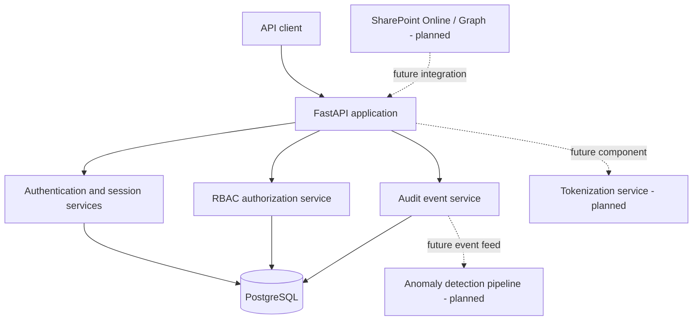
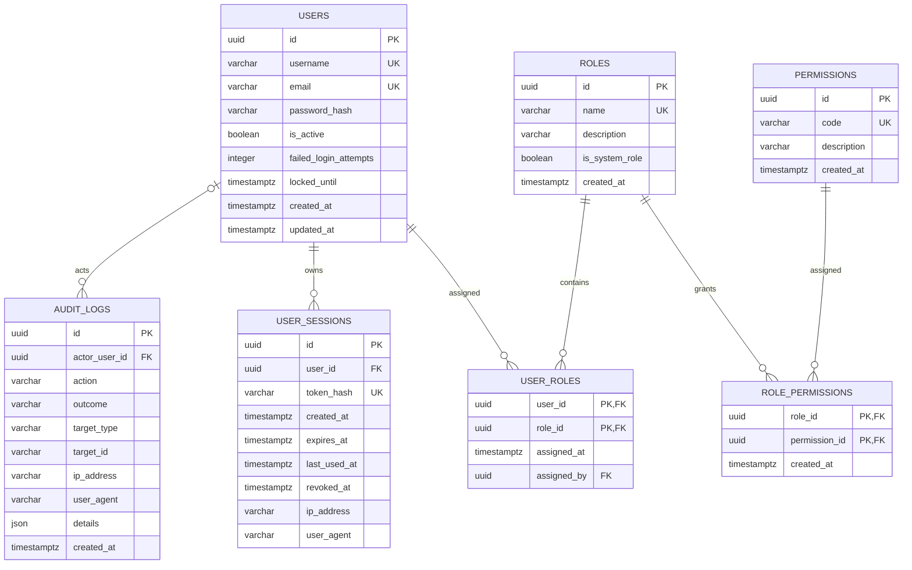

# Secure Banking Information System

**Thesis project:** Design and Implementation of a Secure SharePoint-Based Banking Information System with Role-Based Access Control, Data Tokenization and Access Anomaly Detection

A research prototype for protecting simulated banking information. The project is being developed incrementally: the current implementation focuses on identity, authentication, role-based authorization, session management and security audit logging. SharePoint integration, banking records, tokenization and anomaly detection remain planned research components.

> **Development status:** Early implementation. This is not a production banking system. Only synthetic data is to be used.

## Project objectives

- Implement role-based access control (RBAC) with least-privilege and deny-by-default principles.
- Protect sensitive banking identifiers through tokenization.
- Record security-relevant actions in a structured audit trail.
- Investigate sensitivity-aware, role-conditioned access anomaly detection.
- Compare the proposed detector with rule-based detection and an Isolation Forest baseline.
- Evaluate detection quality, false positives and system overhead using reproducible synthetic experiments.

## Current implementation

| Component | Status |
|---|---|
| PostgreSQL persistence and SQLAlchemy integration | Implemented |
| Alembic schema migrations | Implemented |
| User, role and permission models | Implemented |
| Many-to-many user-role and role-permission assignments | Implemented |
| Argon2id password hashing | Implemented |
| Authentication endpoints (registration, login, current user, logout) | Implemented |
| Session lifecycle and hashed session-token storage | Implemented |
| RBAC service and protected role/permission endpoints | Implemented |
| Structured audit events, including authorization denials | Implemented |
| Initial seeded roles and permissions | Implemented |
| SharePoint Online / Microsoft Graph integration | Planned |
| Banking customers, accounts and transaction domain | Planned |
| Token vault and tokenization service | Planned |
| Access anomaly detection and baseline comparison | Planned |
| Customer and administrator user interfaces | Planned |

The repository currently contains seven implemented database tables: `users`, `roles`, `permissions`, `user_roles`, `role_permissions`, `user_sessions` and `audit_logs`. The banking-domain and token-vault entities described in the database design are proposals, not current tables.

## Architecture at this stage



This diagram deliberately distinguishes the working local security foundation from components intended for later implementation.

## Implemented database schema

The following entity relationship diagram represents the current ORM models and migration files. It is also maintained in [Docs/iam-schema.md](Docs/iam-schema.md).



The diagram shows the persisted relationships. `user_roles.assigned_by` is an additional nullable foreign key to `users.id`; `audit_logs.actor_user_id` is nullable and uses `ON DELETE SET NULL`. Audit rows without an actor can therefore represent events such as unsuccessful unauthenticated login attempts.

## Technology stack

- Python 3.12
- FastAPI and Uvicorn
- PostgreSQL
- SQLAlchemy and Psycopg 3
- Alembic
- Argon2id via `argon2-cffi`
- Pytest

Dependency versions are pinned in [requirements.txt](requirements.txt).

## Repository structure

```text
.
├── Docs/
│   ├── architecture.md
│   ├── database-design.md
│   └── iam-schema.md
├── Experiments/
│   ├── argon2-benchmark-results.md
│   └── benchmark_argon2.py
├── alembic/
│   └── versions/
├── scripts/
│   ├── bootstrap_admin.py
│   └── seed_rbac.py
├── src/
│   ├── api/
│   ├── database/
│   ├── models/
│   └── security/
├── tests/
├── requirements.txt
└── README.md
```

## Technical documentation

The detailed design documents are in the **[Docs/](Docs/)** directory:

- [System architecture](Docs/architecture.md) — components, security boundaries, research direction and implementation status.
- [Database design](Docs/database-design.md) — current persistence foundation and planned banking/tokenization data model.
- [IAM schema](Docs/iam-schema.md) — implemented identity, role, permission, session and audit tables, with the current ER diagram.

## Local development

### 1. Clone and prepare Python

```powershell
git clone https://github.com/klxab/secure-banking-sharepoint.git
cd secure-banking-sharepoint

py -3.12 -m venv .venv
.\.venv\Scripts\Activate.ps1
python -m pip install --upgrade pip
pip install -r requirements.txt
```

### 2. Configure environment variables

Create a local `.env` file in the repository root. It is ignored by Git; never commit it or share its secrets.

The application connection uses the `POSTGRES_*` settings. Alembic is configured to use a separate migration account through `POSTGRES_MIGRATION_USER` and `POSTGRES_MIGRATION_PASSWORD`. Configure that account and the corresponding database privileges locally before running migration commands. Do not reuse or expose passwords in documentation.

The connection configuration is implemented in [src/database/connection.py](src/database/connection.py), and Alembic obtains its separate connection through [alembic/env.py](alembic/env.py).

### 3. Start the local PostgreSQL service

Start your locally installed PostgreSQL 17 service and make sure it is listening on the host and port configured in `.env`. The current development configuration uses `127.0.0.1:5433`.

Create the `banking_dev` database and configure the application runtime account and the separate migration account with the required database privileges before continuing.

### 4. Apply migrations

After configuring the dedicated migration credentials and privileges:

```powershell
alembic upgrade head
```

### 5. Seed role and permission data

```powershell
python scripts/seed_rbac.py
```

### 6. Register and bootstrap the initial administrator

The bootstrap script expects an existing, active user with this designated identity:

- Username: `platform.admin`
- Email: `platform.admin@securebank.test`

Start the API temporarily:

```powershell
uvicorn src.api.main:app --reload
```

Open http://127.0.0.1:8000/docs and use `POST /auth/register` to register that username and email. Use a temporary password that you have not used elsewhere. Stop the API after the account is registered.

Then run:

```powershell
python scripts/bootstrap_admin.py
```

The script prompts for a new password (at least 12 characters), replaces the temporary password with an Argon2id hash and assigns the `system_admin` role in one database transaction. It refuses to run if an administrator already exists.

Do not put administrator passwords in shell history, source code, screenshots or Git.

### 7. Run the API

```powershell
uvicorn src.api.main:app --reload
```

Useful local endpoints:

- Health check: http://127.0.0.1:8000/health
- Database health: http://127.0.0.1:8000/health/database
- Interactive API documentation: http://127.0.0.1:8000/docs

### 8. Run tests

Use the dedicated test database configured for the test environment. The test suite is designed to reject unsafe use of the development database.

```powershell
pytest -v
```

A previously recorded complete test run passed **74 tests**. That is a recorded result, not a claim that tests were executed by this README update. Run the suite in your current environment to verify the current checkout.

## Security notes and limitations

- Use synthetic data only. Do not enter real customer, account, payment or personal information.
- Keep `.env`, database passwords, administrator credentials, session tokens and encryption keys out of Git.
- Passwords are stored as Argon2id hashes; session tokens are stored as hashes.
- Authentication, session management, RBAC and structured audit event recording are implemented.
- Resource ownership and sensitivity-aware authorization are not yet complete.
- Audit logging is not yet tamper-proof; stronger database-level append-only controls and independent integrity verification remain future work.
- CSRF protection and production deployment hardening remain outstanding.
- SharePoint integration, tokenization and anomaly detection are not implemented yet.
- This prototype has not been assessed or certified for production banking use.

## Research direction

The planned research contribution is a **sensitivity-aware, role-conditioned access anomaly detection** approach. Its performance will be evaluated against rule-based detection and an Isolation Forest baseline using controlled synthetic access events. The novelty and effectiveness of the method must be established through literature review and experimental results; they are not assumed.

## License

No license has been specified yet. All rights and reuse permissions are therefore reserved unless a license is added to this repository.
